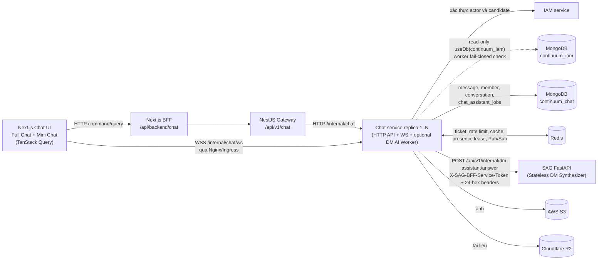
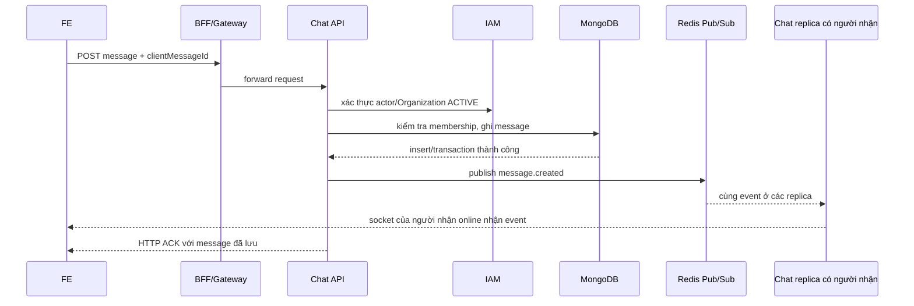

# Chat người dùng — Kiến trúc realtime và khả năng mở rộng đang triển khai

> Nằm trong tài liệu kiến trúc tổng thể. Xem [Mục lục](README.md). Danh mục [tính năng FE–BE](08_HUMAN_CHAT_FE_BE_FEATURES.md), [UI/UX FE](09_HUMAN_CHAT_FE_UI_UX.md), [API/Redis](11_HUMAN_CHAT_REDIS_API_COVERAGE.md) và [Schema `continuum_chat`](../database-design/05_SVC_CHAT_SCHEMA.md) được tách riêng.

Tài liệu này đối chiếu **mã chạy hiện tại** của Chat người với người và trợ lý `@continuumAI` trong Chat 1–1 (`DIRECT`) trên `DATN_BE`/`DATN_FE`/`sag-laya-integration` (cập nhật đồng bộ `28/11/2026`). Đây là hệ thống `DIRECT`/`ROOM` trong một Organization; khác với Cited Assistant/RAG Chat theo project ở các chương kiến trúc cũ (`chat_sessions`/`chat_messages`). Mục tiêu của cách tổ chức hiện tại là giữ tin và hàng đợi tác vụ trợ lý bền vững trong MongoDB, dùng WebSocket để báo thay đổi nhanh, cô lập hoàn toàn quyền truy cập tại Chat service, và cho phép nhiều Chat replica phục vụ các kết nối đồng thời qua Redis. Mã nguồn chưa cung cấp benchmark hay SLO để khẳng định một mức tải cụ thể.

## 1. Topology thực tế và ranh giới service



`services/chat/main.ts` khởi động một NestJS process riêng trên port cấu hình (`3005`); `ChatModule` gồm HTTP controllers, `ChatRealtimeGateway`, application services (`ChatApplicationService`, `ChatFeaturesService`, `DmAssistantRetrievalService`, `ChatDmAssistantWorkerService`) và infrastructure. Để giữ cô lập microservice độc lập (không import `AiEngineModule` hay `IamModule`), `ChatModule` đăng ký trực tiếp `{ provide: AI_ENGINE_CLIENT, useClass: HttpAiEngineClient }` và `{ provide: CHAT_ORG_MEMBERSHIP_CHECKER, useClass: MongoChatOrgMembershipChecker }`. Gateway chỉ forward 38 route Chat hiện có (không thêm route mới cho `@continuumAI` vì toàn bộ hợp đồng mở rộng tương thích ngược trên `/api/v1/chat/**`); nó không giữ message hoặc WebSocket session. BFF dùng cookie/session của ứng dụng và forward HTTP. Nginx Compose và Helm Ingress định tuyến riêng `/internal/chat/ws` thẳng tới Chat, tránh đưa từng WebSocket frame qua Next.js BFF/Gateway. Upload byte đi qua BFF → Gateway → Chat theo stream. Trong Helm hiện `services.chat.replicas: 1` mặc định; kiến trúc hỗ trợ chia kết nối ra nhiều replica và tách riêng HTTP API pod với DM AI worker pod qua biến `CHAT_DM_ASSISTANT_WORKER_ENABLED`, nhưng mặc định triển khai **chưa chứng minh tải nhiều replica**. Nguồn: `DATN_BE/src/services/chat/main.ts`, `chat.module.ts`, `src/gateway/gateway-chat.controller.ts`, `src/integrations/ai-engine/http-ai-engine.client.ts`, `nginx/nginx.conf`, `charts/continuum-ai/templates/gateway-deployment.yaml`, `charts/continuum-ai/values.yaml`; `DATN_FE/src/app/api/backend/[...path]/route.ts` và `src/app/api/backend/forward.ts`.

## 2. Hai đường dữ liệu có vai trò khác nhau

| Đường | Trách nhiệm | Tính chất |
| --- | --- | --- |
| HTTP qua BFF/Gateway | Tạo hội thoại, gửi/sửa/xóa tin, upload, mark read/delivered, search, history, ticket | Có phản hồi HTTP sau xử lý server; kết quả bền vững ghi MongoDB. |
| WebSocket trực tiếp tới Chat | Báo message/conversation event, typing, presence, trạng thái đọc/nhận | Độ trễ thấp, có thể mất event khi socket/Redis Pub/Sub gián đoạn; không phải nguồn sự thật. |
| HTTP history sau reconnect | Tải lại trang tin và danh sách hội thoại, đối chiếu tin đang hiển thị | Bù những event realtime đã bỏ lỡ từ MongoDB; FE loại tin trùng theo ID. |

FE không gửi message bền vững bằng WebSocket. `ChatWorkspace` lấy ticket qua HTTP, mở socket, nghe event để cập nhật/invalidate TanStack Query, và sau frame `connected` làm mới query Chat. `useChat.ts` tải latest page rồi đi lùi bằng cursor đến tin cũ nhất đang hiển thị để hòa giải cả tin mới, tin sửa/xóa khi offline. Đây là cơ chế phục hồi event mất; không có queue chứa mọi frame WebSocket cho từng client. Nguồn: `DATN-FE/src/components/chat/ChatWorkspace.tsx`, `src/lib/queries/chat/useChat.ts`.

## 3. Gửi tin: độ bền trước, fan-out sau



Chat xác minh actor qua IAM, member của conversation và block policy trước khi gửi. Message văn bản thường dùng insert với MongoDB write concern `majority`, timeout 5 giây, rồi cập nhật summary tin cuối có điều kiện theo thời gian/ID. Gửi có tệp, reply hoặc `assistantMention` (`@continuumAI` trên hội thoại `DIRECT`) dùng MongoDB transaction để xác minh/tiêu thụ upload `READY`, kiểm tra reply target, insert message (`contentVersion: 0`), tạo bản ghi outbox `chat_assistant_jobs` (nếu có `assistantMention`) và cập nhật summary nguyên tử. Unique index `{conversationId, senderId, clientMessageId}` chống ghi trùng; cùng ID với payload hoặc `assistantMention` khác trả `409 CHAT_IDEMPOTENCY_CONFLICT`. Direct dùng unique `directKey`; room dùng `creationKey` từ `clientRoomId`. HTTP ACK gắn với kết quả ghi, **không đợi** người nhận online, xác nhận WebSocket hay tiến trình xử lý AI. Nguồn: `application/chat.service.ts`, `infrastructure/mongodb/mongo-chat.repository.ts`, `infrastructure/persistence.ts`.

Sau ghi, `ChatRealtimeService.publishConversationEvent()` publish vào một Redis channel chung (`<BULLMQ_PREFIX>:chat:events:v1`, prefix mặc định `continuum`) cho các event `message.*`, `conversation.*` và `assistant.status`. Lỗi publish bị bắt để tin đã lưu vẫn đọc được. Do đó Redis Pub/Sub ở đây là kênh tín hiệu **at-most-once**, không phải log replay bền vững. `OutboxService` chung và `CHAT_QUEUES` (mảng rỗng) không dùng cho đường gửi tin người hay fan-out Pub/Sub; riêng tác vụ trả lời `@continuumAI` dùng hàng đợi outbox bền vững `chat_assistant_jobs` trên MongoDB với cơ chế claim/lease trong `ChatDmAssistantWorkerService` (xem Mục 10). Nguồn: `application/chat-realtime.service.ts`, `application/chat-dm-assistant.worker.ts`, `infrastructure/chat.infrastructure.module.ts`, `infrastructure/persistence.ts`.

## 4. Fan-out nhiều replica: đang làm gì và chi phí thực

Mỗi Chat process giữ các map **cục bộ**: socket theo `(organizationId,userId)`, socket theo conversation đã subscribe, presence watcher và trạng thái session. Redis Pub/Sub chuyển event đến **mọi** Chat replica đang subscribe channel chung. Mỗi replica sau đó chỉ gửi message/conversation event tới socket cục bộ của `recipientIds`; typing chỉ tới socket đã subscribe conversation; presence chỉ tới watcher đủ điều kiện. Không cần sticky session để message đi tới người dùng ở replica khác vì mỗi replica nhận cùng envelope. Khi socket bị đóng, map cục bộ được dọn và client reconnect tới replica sẵn có.

Chi phí hiện tại gần đúng là `số event × số Chat replica` cho việc nhận/lọc envelope nội bộ, cộng `số socket người nhận online` cho fan-out thực. Một room có `R` message/giây và `K` recipient online vẫn cần xấp xỉ `R × K` lần gửi socket; Redis không làm chi phí này biến mất. Thiết kế phù hợp khi replica và room chưa quá lớn, nhưng global Pub/Sub sẽ tăng tải Redis/network/CPU trên **mọi** replica khi traffic tăng. Chưa có node-targeted routing, consistent hashing, shard theo conversation hay relay chuyên biệt. Nguồn: `application/chat-realtime.service.ts` (`publish`, `receive`, `userSockets`, `conversationSockets`, `presenceWatchers`).

## 5. Kết nối, backpressure, typing và presence

- Ticket WebSocket được cấp qua HTTP, ngẫu nhiên 32 byte, TTL tối đa 30 giây, lưu Redis và consume một lần bằng Lua. Ticket đi trong `Sec-WebSocket-Protocol`, không nằm trong query URL. Handshake so khớp token hash/actor/organization với IAM và ticket; `Origin` phải nằm trong `CHAT_ALLOWED_ORIGINS`.
- Gateway dùng NestJS `ws` adapter. Frame tối đa 16 KiB, không bật WebSocket compression. Client có `bufferedAmount > 256 KiB` bị đóng với mã `1013` để tránh queue gửi tăng không giới hạn.
- Mỗi 20 giây server ping socket, kiểm tra token hết hạn/Redis revoke, và revalidate IAM theo cache tối đa 60 giây. Socket không pong hoặc session không còn hợp lệ bị đóng.
- Presence là Redis sorted set lease theo từng session/device, TTL logic 75 giây. User online khi còn lease hợp lệ; heartbeat/pong gia hạn lease, không ghi MongoDB. Presence watch chỉ chấp nhận tối đa 100 user ID và BE thu hẹp về direct contacts có quyền, không broadcast online của cả tổ chức. Watcher nhận snapshot rồi nhận thay đổi; khi lease hết, vòng ping đọc lại trạng thái để phát offline.
- Typing là event tạm, không ghi MongoDB. Server throttle typing-start mỗi socket trong 400 ms; FE tự hết trạng thái typing sau 2,5 giây nếu không có cập nhật.

Nguồn: `controllers/chat-realtime.gateway.ts`, `application/chat-realtime.service.ts`, `application/chat.service.ts`, `infrastructure/redis/redis.service.ts`, `DATN-FE/src/components/chat/ChatWorkspace.tsx`.

## 6. MongoDB và Redis hỗ trợ chịu tải như thế nào

MongoDB database `continuum_chat` sở hữu các collection người dùng `chat_conversations`, `chat_members`, `chat_conversation_messages`, `chat_assistant_jobs` (outbox `@continuumAI`), `chat_uploads`, `chat_notifications`, `chat_blocks`, `chat_reports`. `chat_sessions`/`chat_messages` là dữ liệu Cited Assistant riêng theo project, không phải human message timeline. Room member là document riêng, tránh mảng thành viên tăng vô hạn trong conversation. Member lưu `lastDeliveredMessageId/At`, `lastReadMessageId/At` dạng cursor và `draftAssistantMention`; không tạo một receipt document cho từng cặp message–recipient. `chat_conversations` có trường `contextRevision` tăng nguyên tử khi sửa/xóa tin người dùng trong `DIRECT` và khi worker AI cam kết; `chat_conversation_messages` có các trường tùy chọn cho AI (`contentVersion`, `authorType`, `assistantMention`, `triggerMessageId`, `assistantStatus`, `assistantFailureCode`, `assistantMeta`, `sourceReferences`) và 2 partial index trên `authorType: 'ASSISTANT'` cùng 4 index trên `chat_assistant_jobs` được bổ sung qua migration `20261128-chat-dm-assistant-schema` (xem [05_SVC_CHAT_SCHEMA.md](../database-design/05_SVC_CHAT_SCHEMA.md)). Lịch sử phân trang bằng `(createdAt,_id)` nên không dùng `skip/offset` trên lịch sử dài. Nguồn: `infrastructure/persistence.ts`, `infrastructure/mongodb/mongodb.schemas.ts`, `mongo-chat.repository.ts`, `scripts/migrations/20261128-chat-dm-assistant-schema.mjs`.

Redis giữ rate limit cho **mọi route HTTP nghiệp vụ** Chat (bao gồm hạn mức riêng `dm-assistant:<orgId>:<userId>` cho lượt gọi `@continuumAI`), ticket một lần, presence lease và Pub/Sub. Repository cache wrapper giữ một số kết quả đọc 15 giây theo actor/organization, tham số và `cache-generation`; trước cache hit vẫn kiểm tra membership phù hợp. Trang history còn có cache-aside riêng 10 giây theo actor/conversation/cursor và `history-version`. Mọi mutation tin nhắn và chuyển trạng thái job AI đều đồng thời tăng **cả hai khóa** `<prefix>:chat:history-version:<orgId>:<convId>` và `<prefix>:chat:cache-generation:<orgId>` (qua `ChatApplicationService.bumpHistoryVersion` / `ChatHistoryCacheInvalidator.invalidate`) để tránh phục vụ `sourceReferences[].status` cũ sau khi sửa/xóa nguồn. Cache không thay thế MongoDB. Tuy nhiên `ChatTrafficGuard` cần Redis để cho request đi tiếp: cache history có nhánh fallback Mongo khi Redis lỗi, nhưng ở mức HTTP toàn route có thể không tới nhánh đó nếu rate limit guard không dùng được. Đây là giới hạn availability hiện tại, không nên mô tả là Chat HTTP hoạt động đầy đủ khi Redis outage. Nguồn: `controllers/chat-traffic.guard.ts`, `infrastructure/redis/chat-cache.repository.ts`, `application/chat-history-cache.ts`, `application/chat.service.ts`.

Search tên/hội thoại dùng MongoDB Search autocomplete theo tiền tố từ và chuẩn hóa dấu; email dùng range tiền tố theo index; nội dung tin dùng MongoDB Search text với tenant/conversation/sender/date filter. Search across còn lookup membership trước khi trả kết quả. Đây là đường tìm kiếm riêng, không quét `%keyword%` hai đầu trên mọi message. Nguồn: `src/common/search/indexed-search.ts`, IAM candidate search, `mongo-chat.repository.ts`, `mongo-chat-features.ts`.

## 7. Media và tác động lên đường nóng

Ảnh dùng AWS S3, tài liệu dùng Cloudflare R2 qua adapter SDK. FE tạo upload record, stream byte qua BFF/Gateway/Chat; Chat giới hạn số byte theo metadata đã khai, ghi object, `HEAD` xác minh kích thước/MIME khi complete, rồi message tham chiếu upload ID. Download cần kiểm tra membership trước khi cấp signed GET URL 5 phút; ảnh `inline`, tài liệu `attachment`. URL ký được cache ngắn hạn trong Redis. Đường upload đi qua hai HTTP hop có thể tiêu thụ băng thông/connection của BFF và Gateway; Nginx tắt request buffering cho route upload. Đây là cân nhắc tải riêng với fan-out tin nhắn. Nguồn: `application/chat.service.ts`, `infrastructure/storage/s3.storage.ts`, `r2.storage.ts`, Gateway forwarder, FE BFF route, `nginx/nginx.conf`.

## 8. Hành vi khi lỗi và giới hạn mở rộng hiện tại

| Tình huống | Hành vi có trong code | Giới hạn |
| --- | --- | --- |
| Client/socket mất kết nối | FE reconnect backoff + jitter, đăng ký lại, refetch và đồng bộ history. | Event Pub/Sub trong lúc offline không được replay; phải lấy từ MongoDB. |
| Chat process chết | Socket trên process đó mất; presence lease hết hạn và client nối lại. | Chuyển online/offline có thể trễ tới khi lease được phát hiện hết hạn. |
| Redis Pub/Sub publish lỗi sau khi ghi tin | Lỗi bị bắt, message vẫn tồn tại và HTTP có thể trả kết quả. | Người nhận có thể không nhận event tức thời; bù qua HTTP. |
| Redis rate limit/ticket/presence không khả dụng | Guard/ticket/presence phụ thuộc Redis; readiness probe Redis báo không sẵn sàng. | Không thể tuyên bố toàn bộ Chat tiếp tục hoạt động khi Redis outage. |
| MongoDB ghi lỗi | Không có ACK thành công cho tin mới; FE có thể retry cùng ID. | Không có message bền vững để replay nếu MongoDB chưa commit. |
| Socket người nhận chậm | Đóng khi send buffer vượt 256 KiB. | Người nhận phải reconnect và tải bù history. |
| Một room quá nóng hoặc tăng nhiều replica | Mọi replica nhận mọi event từ channel chung rồi lọc; socket fan-out vẫn tỷ lệ số người nhận. | Chưa có node-directed channel, room shard hoặc benchmark công bố. |
| Nguồn DM bị sửa/xóa trong lúc SAG đang sinh câu trả lời | Worker khóa lạc quan bằng `contextRevision` (Step 5a) và kiểm tra lại toàn bộ `triggerMessage` + `sentMessages` trong transaction; nếu bị sửa/xóa thì hủy job `CANCELLED` (`SOURCE_CHANGED` / `TRIGGER_DELETED`), không đăng tin AI. | Xung đột commit lặp lại quá `MAX_COMMIT_TX_ATTEMPTS = 3` chuyển về retry có backoff (`SERVICE_UNAVAILABLE`). |
| Quyền hội thoại/tổ chức IAM bị thu hồi hoặc DM bị block giữa chừng | Worker re-check IAM `organization_memberships` + `users` (fail-closed) và `chat_members`/`chat_blocks` trước gọi SAG và trước commit; hủy `CANCELLED / ACCESS_REVOKED` và loại `requesterUserId` bị thu hồi khỏi WS fan-out. | Lỗi kết nối tạm thời tới `continuum_iam` kích hoạt retry (`SERVICE_UNAVAILABLE`), tuyệt đối không bỏ qua kiểm tra để đăng câu trả lời. |
| SAG timeout, 503 hoặc trả JSON/citation bịa | `HttpAiEngineClient` tách timeout `CHAT_DM_ASSISTANT_SAG_TIMEOUT_MS` (`504` → `TIMEOUT`), bảo toàn `503` (`SERVICE_UNAVAILABLE`) và `502` (`INVALID_MODEL_OUTPUT`); worker retry hữu hạn (`maxAttempts=3`), không chèn trùng nhờ unique `triggerMessageId`. | Không tạo tin AI lỗi trong timeline; chỉ cập nhật `assistantState` trên tin gọi kèm nút thử lại trên FE. |

Mã hiện có đã đặt nền cho scale ngang bằng service process riêng, ingress WSS trực tiếp, Redis cross-replica và persistence không phụ thuộc socket. **Nó chưa chứng minh chịu tải cao bằng số liệu.** Trước khi nâng replica/room limit cần đo đồng thời: active sockets/replica, memory/socket, event-loop lag, p95/p99 HTTP send→ACK, Mongo majority latency, Redis publish/subscriber lag, event/s theo room, recipient fan-out, reconnect storm và tỷ lệ tải bù. Chỉ khi channel chung hoặc socket fan-out đo được là nút thắt mới có cơ sở tách WebSocket worker/relay hay định tuyến event theo node/conversation; các thành phần đó **chưa được triển khai**.

`DATN-BE/src/services/chat/ARCHITECTURE.md` là tài liệu thiết kế có vài đoạn cũ (ví dụ upload signed PUT trực tiếp và search chuỗi con). Khi khác với code đang chạy, các file runtime nêu ở từng mục trên là nguồn cho tài liệu hiện trạng này. Không có thay đổi application code hay topology triển khai trong tài liệu này.

## 9. Công nghệ và cơ chế đang dùng để bảo đảm chất lượng

Bảng này phân biệt **công nghệ đã có trong đường chạy Chat** với tác dụng thực tế của nó. Phiên bản phụ thuộc được khai báo trong `DATN-BE/package.json` và `DATN-FE/package.json`; cấu hình triển khai có trong Compose/Helm. Một dependency xuất hiện trong manifest chưa có nghĩa Chat đang dùng nó trên đường gửi tin.

| Thuộc tính chất lượng | Công nghệ/cơ chế đang dùng | Tác dụng trong Chat và bằng chứng mã nguồn |
| --- | --- | --- |
| Phân tách trách nhiệm | NestJS 11, TypeScript, module/controller/application service/repository, entrypoint Chat riêng | Gateway forward HTTP; Chat sở hữu business logic, WebSocket và `continuum_chat`. Có thể triển khai/điều chỉnh Chat độc lập với UI. `chat.module.ts`, `main.ts`, `gateway-chat.controller.ts`. |
| Độ bền và tính nhất quán | MongoDB replica set, Mongoose 8, unique/compound/TTL indexes, transaction, majority write concern | Tin nhắn được ghi trước khi phát event; retry dùng unique key; room và tin có file/reply dùng transaction; cursor tránh `skip` lớn. `mongo-chat.repository.ts`, `persistence.ts`, `mongodb.schemas.ts`. |
| Realtime ngang replica | NestJS `@nestjs/platform-ws`/`ws`, Nginx hoặc Kubernetes Ingress WebSocket Upgrade, Redis Pub/Sub qua ioredis | Socket đi thẳng tới Chat; một event được chuyển tới các Chat replica rồi lọc theo socket cục bộ. `service-bootstrap.ts`, `chat-realtime.gateway.ts`, `chat-realtime.service.ts`, `nginx/nginx.conf`, Helm ingress. |
| Bảo vệ bộ nhớ và lưu lượng | `ws` max payload 16 KiB, tắt compression, giới hạn send buffer 256 KiB, Redis rate limit theo actor, phân trang cursor | Chặn frame quá lớn, client quá chậm, request dồn dập và lịch sử trả không giới hạn. `chat-realtime.gateway.ts`, `chat-realtime.service.ts`, `chat-traffic.guard.ts`, `chat.service.ts`. |
| Phục hồi kết nối | WebSocket heartbeat, Redis presence lease, ticket dùng một lần, FE reconnect với backoff/jitter, TanStack Query refetch và `syncMessages` | Mất socket không làm mất message đã lưu; FE đồng bộ từ MongoDB qua HTTP sau reconnect. `chat-realtime.service.ts`, `ChatWorkspace.tsx`, `useChat.ts`. |
| Cô lập tenant và session | IAM service, active Organization Membership, conversation membership, Origin allowlist, token hash/ticket binding, kiểm tra session định kỳ | Chat lấy actor từ IAM; kiểm tra quyền trước cache/history/socket subscribe/download. `chat-iam.client.ts`, `chat-realtime.gateway.ts`, repository Chat. |
| Search có kiểm soát | MongoDB Search index `chat_search_v1`, autocomplete theo tiền tố từ, text search, B-tree prefix cho email | Tìm nhiều từ/không dấu, lọc organization/member và phân trang; không dùng wildcard hai đầu để quét collection. `src/common/search/indexed-search.ts`, Chat/IAM search repositories. |
| Media riêng tư | AWS SDK S3 client/presigner cho ảnh và R2 S3-compatible client cho tài liệu; upload stream có kiểm tra byte và `HEAD` | Bucket không cần public-read; Chat xác minh membership trước signed GET URL, kiểm tra metadata trước gắn file vào tin. `s3.storage.ts`, `r2.storage.ts`, `chat.service.ts`. |
| Trạng thái FE | Next.js 16, React 19, TanStack Query 5, TypeScript | Query/mutation và invalidation tách khỏi local UI state; nhận event xong làm mới dữ liệu, hiển thị loading/error/retry. `useChat.ts`, `features.ts`, `ChatWorkspace.tsx`. |
| Contract và kiểm thử | `docs/openapi/chat-v1.openapi.json` (v`1.2.0`), `SAG/docs/openapi/sag-api.openapi.json` (`115` paths); Jest + Node migration tests ở BE, pytest ở SAG, Vitest/RTL ở FE; synthetic DM dataset (`Dataset/continuum-dm-ai-dataset/`) | Có contract route và test cho service, repository, Redis cache/route guard, realtime, DM `@continuumAI` retrieval/worker/anti-race commit, SAG grounded synthesis, composer, bubble và tìm kiếm/highlight. Đây là khả năng kiểm thử trong repo, không phải bằng chứng load test đã đạt. |
| Health và triển khai | Readiness probe MongoDB/Redis; Docker Compose microservices; Helm Deployment/Service/Ingress; feature flags `CHAT_DM_ASSISTANT_ENABLED` / `CHAT_DM_ASSISTANT_WORKER_ENABLED` | `/internal/health/ready` kiểm tra dependency, chỉ trả HTTP 200 khi cả MongoDB và Redis sẵn sàng. Compose chạy Chat riêng trên port 3005; Helm cấu hình replica mặc định là 1 và hỗ trợ tách API pod với worker pod. `service-bootstrap.ts`, `service-readiness.ts`, `docker-compose.microservices.yml`, Helm chart. |

### Ranh giới chất lượng chưa được chứng minh hoặc chưa nối vào Chat

- `CHAT_QUEUES` đang rỗng: BullMQ có trong dependency/module infrastructure nhưng **không** phân phối message hoặc fan-out Chat hiện tại. `OutboxService` chung cũng chưa được gọi từ đường gửi tin người dùng, nên không có replay bền vững cho Pub/Sub event; riêng luồng `@continuumAI` sử dụng outbox MongoDB chuyên biệt `chat_assistant_jobs` do `ChatDmAssistantWorkerService` xử lý theo mô hình lease/polling.
- `MetricsModule` đang được import trong Gateway, **không** thấy import trong `ChatModule`; chưa có metric Chat chuyên biệt trong mã được rà như số socket/replica, fan-out mỗi room, Redis subscriber lag, event-loop lag hoặc p99 send→ACK. Health/readiness không thay thế đo tải.
- Test Jest/Vitest/pytest xác minh logic, schema, ACL và component, nhưng tài liệu này chưa thấy load test cho nhiều replica, room nóng, reconnect storm hay sự cố Redis/Mongo trong cấu hình giống production. Không suy ra thông lượng hoặc số kết nối tối đa từ package version.
- Manifest Helm cho phép tăng `services.chat.replicas`; muốn tuyên bố chịu tải cao cần chạy benchmark và theo dõi đồng thời độ trễ Mongo majority, CPU/memory Chat, Redis Pub/Sub, socket buffer và tốc độ đồng bộ sau reconnect.

---

## 10. Trợ lý `@continuumAI` trong Chat 1–1 (`DIRECT`)

Tính năng cho phép thành viên `A` hoặc `B` trong cuộc hội thoại `DIRECT` chọn mention có cấu trúc `@continuumAI` để hỏi/tóm tắt dựa **nghiêm ngặt** trên lịch sử tin nhắn văn bản của chính cặp hội thoại đó, không cần bật xác nhận hai chiều riêng. Câu trả lời được đăng thành một tin `authorType: 'ASSISTANT'` ngay trong dòng thời gian chung của `A` và `B`, kèm trích dẫn `[M#]` dẫn tới tin gốc.

### 10.1. Luồng xử lý end-to-end

```mermaid
sequenceDiagram
    actor U as A hoặc B (FE Full/Mini Chat)
    participant API as Chat HTTP API (DATN_BE)
    participant MG as MongoDB (continuum_chat)
    participant IAM as MongoDB (continuum_iam)
    participant WK as ChatDmAssistantWorkerService
    participant SAG as SAG FastAPI (/internal/dm-assistant/answer)
    participant RD as Redis (Cache + Pub/Sub)

    U->>API: POST /messages (+ structured assistantMention)
    API->>RD: Rate limit dm-assistant (15/60s) + send limit
    API->>MG: Tx: insert trigger msg + chat_assistant_jobs (PENDING) + lastMessage*
    API->>RD: Bump history-version + cache-generation; publish message.created & assistant.status (PENDING)
    API-->>U: HTTP 201 trigger message (assistantState: PENDING)

    WK->>MG: Atomic findOneAndUpdate claim (PROCESSING + 60s lease, renew 15s)
    WK->>IAM: Fail-closed check organization_memberships & users ACTIVE
    WK->>MG: Pre-SAG guard (DM ACTIVE, member ACTIVE, unblocked, trigger unedited/undeleted)
    WK->>MG: Dual-mode strictly scoped retrieval (TIME_WINDOW / KEYWORD / HYBRID) + snapshot versions
    WK->>SAG: POST /api/v1/internal/dm-assistant/answer (<=80 msgs, <=24k chars, no-store)
    SAG-->>WK: JSON { status: ANSWERED | INSUFFICIENT_EVIDENCE, answerText, citedRefIds }

    WK->>IAM: Re-verify IAM active org/user (outside continuum_chat tx)
    WK->>MG: Commit Tx (<=3 retries): verify lease, access, trigger & ALL sentMessages snapshots
    WK->>MG: Step 5a contextRevision fence ($inc 1) → Step 6 insert 1 AI msg → Step 5b monotonic lastMessage* → Step 7 mark job + notifications
    WK->>RD: Invalidate history-version + cache-generation; publish message.created & assistant.status strictly to [A, B]
```

### 10.2. Ranh giới quyền, truy xuất và tổng hợp stateless

1. **Chat BE sở hữu toàn bộ ACL & dữ liệu (`DATN_BE`):**
   - Mọi đường HTTP (`POST /messages`, `GET /messages`, `aroundMessageId`, search, library, forward, pin, draft, receipts) và WebSocket dùng chung kiểm tra `requireMember` trên `(organizationId, conversationId, userId, status: 'ACTIVE')`. Người ngoài hội thoại (`C` cùng org, Org `ADMIN`/Manager không thuộc DM, `PLATFORM_OPERATOR`, hoặc user khác org) luôn bị chặn `404` / không nhận WS event.
   - **IAM fail-closed re-check trong worker:** `MongoChatOrgMembershipChecker` dùng `chatConnection.useDb(SERVICE_DATABASES.iam, { useCache: true })` kiểm tra đồng thời `organization_memberships(status: 'ACTIVE')` và `users(status: 'ACTIVE')` ở **cả hai mốc** (trước gọi SAG và đầu mỗi lượt vòng commit). Nếu `false` → hủy job `CANCELLED / ACCESS_REVOKED` và **loại `requesterUserId` khỏi danh sách nhận WS `assistant.status`** để tài khoản đã thu hồi không nhận event. Nếu lỗi DB IAM tạm thời → ném lỗi retry (`SERVICE_UNAVAILABLE`), tuyệt đối không bỏ qua kiểm tra.
2. **Truy xuất 2 chế độ + fallback chống miss (`DmAssistantRetrievalService`):**
   - **Pre-retrieval hard filter bắt buộc:** `{ organizationId, conversationId, deletedAt: null, authorType: { $ne: 'ASSISTANT' }, senderId: { $ne: 'assistant:continuum_ai' }, _id: { $ne: triggerMessageId }, createdAt: { $lte: triggerMessage.createdAt }, content: { $type: 'string', $ne: '' } }`. Loại trừ hoàn toàn tin AI cũ, tin đã xóa, tệp đính kèm, dự án, web và hội thoại khác.
   - **`TIME_WINDOW`:** Chuẩn hóa mốc thời gian tương đối ("hôm qua", "tuần trước", ngày cụ thể) theo IANA `timezone` của lượt hỏi, đọc theo index `{ conversationId: 1, createdAt: -1, _id: -1 }` và sắp tăng dần thời gian.
   - **`KEYWORD` & `HYBRID`:** Ưu tiên MongoDB Atlas Search `$search` trên `chat_search_v1` (BM25, analyzer `folded`, lọc `organizationId` & `conversationId`, top 25 ứng viên). Khi Atlas Search không khả dụng (`31082`/`40324`) **hoặc trả 0 hit** (ví dụ trễ lập chỉ mục hoặc sai khác token), tự động fall-through sang MongoDB `$text` trên index hiện hữu (`ATLAS_SEARCH_THEN_MONGO_TEXT` / `MONGO_TEXT`), và nếu vẫn 0 hit thì quét có giới hạn tối đa `500` tin đủ điều kiện gần nhất so khớp không dấu trong bộ nhớ (`ATLAS_SEARCH_THEN_FOLDED_SCAN` / `MONGO_TEXT_THEN_FOLDED_SCAN` / `FOLDED_SCAN`). Với tối đa `15` ứng viên khớp cao nhất, mở rộng `±2` tin liền kề theo `(createdAt, _id)` để giữ trọn tin xác nhận ngắn và tin đính chính, rồi khử trùng và đọc bản ghi gốc theo `_id`.
   - **Ngân sách ngữ cảnh cứng:** Cắt từng tin tối đa `1200` ký tự, tổng tối đa `80` tin (`CHAT_DM_ASSISTANT_MAX_CONTEXT_MESSAGES`) và `24.000` ký tự (`CHAT_DM_ASSISTANT_MAX_CONTEXT_CHARS`); đặt `partialCoverage: true` + `coverageHint` mỗi khi bị cắt bớt.
3. **SAG Stateless Grounded Synthesizer (`sag-laya-integration`, commit `3aa4987`):**
   - Endpoint nội bộ `POST /api/v1/internal/dm-assistant/answer` (`api/v1/dm_assistant.py`, `schemas/dm_assistant.py`, `services/dm_assistant_service.py`) xác thực fail-closed bằng `X-SAG-BFF-Service-Token` (`secrets.compare_digest`; chưa cấu hình → `503`, sai/thiếu hoặc chỉ gửi `Authorization: Bearer` → `403`) cùng 3 header 24-hex bắt buộc `X-Continuum-Organization-Id`, `X-Continuum-User-Id`, `X-Continuum-Conversation-Id` (`403`); từ chối mọi query param (`400`) và mọi trường thừa (`extra="forbid"` → `422`); luôn trả `Cache-Control: no-store`.
   - **Không inject DB session, Qdrant hay web retrieval:** `messages: []` short-circuit ngay về `200 INSUFFICIENT_EVIDENCE` (`usage.calls = 0`). Khi có tin nhắn, gọi `LLMClient.complete(..., response_format={"type":"json_object"}, temperature=0.1, max_tokens=1024)` trong giới hạn `min(settings.llm_timeout_ms, 40_000)`ms (`503 llm_unavailable`). Prompt cách ly `question` và `messages[].text` như dữ liệu không tin cậy; từ chối cứng mọi `citedRefIds` không nằm trong tập đầu vào (`502 schema_validation_error`); hạ cấp an toàn `ANSWERED` không có `citedRefIds` về `INSUFFICIENT_EVIDENCE`.
   - Phía `DATN_BE`, `HttpAiEngineClient` rẽ nhánh timeout sang `CHAT_DM_ASSISTANT_SAG_TIMEOUT_MS` (mặc định `45.000`ms → `504 AI_ENGINE_TIMEOUT`) và **bảo toàn HTTP `503`** thành `ServiceUnavailableException` (`AI_ENGINE_UNAVAILABLE`) để phân tách hoàn toàn lỗi retryable (`503`/`504`) khỏi `502` (`INVALID_MODEL_OUTPUT`).

### 10.3. Chống race condition, làm giàu trạng thái nguồn và bất biến tin AI

- **Tách bước 5a / 5b trong giao dịch cam kết (`ChatDmAssistantWorkerService`):**
  - *Step 5a (`contextRevision` Fence):* Sau khi kiểm tra lại lease, quyền, `triggerMessage` (không xóa, không đổi `contentVersion`/`editedAt`) và toàn bộ `sentMessages` snapshot, worker chạy `chat_conversations.updateOne` lọc theo `status: 'ACTIVE'` và đúng `observedContextRevision` (hỗ trợ document cũ chưa có trường này bằng `$or: [{ contextRevision: 0 }, { contextRevision: { $exists: false } }]`) kèm `$inc: { contextRevision: 1 }`. Thao tác này tạo write-lock thật trên document hội thoại, loại trừ hoàn toàn snapshot write-skew với `editMessage`/`deleteMessage` đồng thời (cả hai đều tăng nguyên tử `contentVersion` và `contextRevision`; riêng `deleteMessage` lặp lại trên tin đã xóa là NOOP và không tăng). Nếu `matchedCount === 0` hoặc `WriteConflict`, worker abort transaction, đọc lại `contextRevision` mới và thử lại tối đa `3` lượt (`MAX_COMMIT_TX_ATTEMPTS`).
  - *Step 6 (Chèn duy nhất 1 tin AI):* Ghi tin `authorType: 'ASSISTANT'`, `senderId: 'assistant:continuum_ai'`, `clientMessageId: 'assistant:' + triggerMessageId`, `replyToMessageId: triggerMessageId` được bảo vệ cứng bởi partial unique index `chat_messages_assistant_trigger_unique` (lỗi `11000` sau crash-recovery sẽ đối chiếu tin AI đã tồn tại và hoàn tất job không chèn trùng).
  - *Step 5b (Cập nhật đơn điệu `lastMessage*`):* Tách thành lệnh `updateOne` riêng có điều kiện `lastMessageAt === null || lastMessageAt <= aiMsgCreatedAt` để không bao giờ ghi đè preview của tin người dùng mới hơn, đồng thời không làm nhiễu điều kiện `matchedCount === 0` của Step 5a.
- **Làm giàu trạng thái nguồn theo thời điểm đọc (`enrichSourceReferences`):**
  - Không lưu `status` tĩnh của trích dẫn trong DB. Mỗi lần `mapMessages` tải lịch sử/tìm kiếm/thư viện ghim, BE truy vấn theo lô toàn bộ `sourceReferences[].messageId` trong `(organizationId, conversationId)` để tính sống `status`: `DELETED` (và bắt buộc `quoteSnippet: ''`) nếu thiếu document hoặc `deletedAt !== null`; `EDITED` nếu đổi `contentVersion` hoặc `editedAt` (giữ `quoteSnippet` rút gọn ban đầu, cho phép bấm mở bản mới qua `aroundMessageId`); ngược lại `ACTIVE`. Đồng thời tổng hợp `assistantMeta.sourceState` (`FRESH`, `HAS_EDITED`, `HAS_DELETED`, `HAS_EDITED_AND_DELETED`) và hydrate `assistantState` từ `chat_assistant_jobs` lên tin người gọi chưa bị xóa.
  - Kết hợp dual Redis invalidation (`history-version` + `cache-generation`) trên BE và TanStack Query prefix invalidation `chatKeys.messages(orgId, convId)` (phủ cả `context`) khi nhận `message.updated`/`message.deleted`/`assistant.status` trên cả `ChatWorkspace` lẫn `useFloatingChatRealtime`.
- **Tính bất biến của tin AI đã đăng:** Câu trả lời AI đã đăng giữ nguyên nội dung như lịch sử; `PATCH` và `DELETE` từ thành viên trả `403 CHAT_ASSISTANT_MESSAGE_IMMUTABLE` (người ngoài nhận `404`), `POST /forward` trả `422 CHAT_ASSISTANT_FORWARD_FORBIDDEN`. Thành viên vẫn có thể thả reaction, reply, ghim và báo cáo tin AI.

### 10.4. Feature flags, biến môi trường và mô hình tách pod API / Worker

| Biến môi trường (`DATN_BE`) | Mặc định | Biên hợp lệ | Vai trò vận hành |
| --- | --- | --- | --- |
| `CHAT_DM_ASSISTANT_ENABLED` | `false` | boolean | Kill-switch bật/tắt nhận mention và quảng bá `capabilities.dmAssistantEnabled`. |
| `CHAT_DM_ASSISTANT_WORKER_ENABLED` | Kế thừa `CHAT_DM_ASSISTANT_ENABLED` | boolean (tùy chọn) | Bật/tắt vòng poll `ChatDmAssistantWorkerService` độc lập cho kiến trúc tách pod API (`false`) và pod worker (`true`) hoặc drain bảo trì. |
| `CHAT_DM_ASSISTANT_SAG_TIMEOUT_MS` | `45000` | `5000..90000` | Timeout phía `HttpAiEngineClient` gọi SAG (`504 AI_ENGINE_TIMEOUT`). |
| `CHAT_DM_ASSISTANT_RATE_LIMIT_PER_MINUTE` | `15` | `1..120` | Giới hạn lượt gọi `@continuumAI` mỗi `(organizationId, userId)` trong 60 giây (`429 CHAT_ASSISTANT_RATE_LIMITED`). |
| `CHAT_DM_ASSISTANT_MAX_RETRIES` | `3` | `1..5` | Số lần thử tối đa của mỗi job `chat_assistant_jobs`. |
| `CHAT_DM_ASSISTANT_LEASE_MS` | `60000` | `10000..300000` | Thời hạn lease mỗi worker claim (tự gia hạn mỗi `leaseMs / 4`). |
| `CHAT_DM_ASSISTANT_POLL_INTERVAL_MS` | `1000` | `200..60000` | Chu kỳ poll khi hàng đợi rảnh (khi còn việc chuyển về `50`ms). |
| `CHAT_DM_ASSISTANT_MAX_CONTEXT_MESSAGES` | `80` | `1..80` | Số tin nhắn tối đa gửi sang SAG mỗi lượt hỏi. |
| `CHAT_DM_ASSISTANT_MAX_CONTEXT_CHARS` | `24000` | `1000..24000` | Tổng số ký tự ngữ cảnh tối đa gửi sang SAG mỗi lượt hỏi. |

- **Split-pod capability semantics:** `dmAssistantAvailable = (CHAT_DM_ASSISTANT_ENABLED === true) && Boolean(SAG_API_BASE_URL) && Boolean(SAG_BFF_SERVICE_TOKEN)`. Công thức cố ý **không** phụ thuộc `CHAT_DM_ASSISTANT_WORKER_ENABLED` để HTTP API pod tắt worker vẫn quảng bá `capabilities.dmAssistantEnabled: true` trên hội thoại `DIRECT` và nhận job vào `chat_assistant_jobs` cho worker pod riêng xử lý; trong triển khai đơn tiến trình, bỏ trống `CHAT_DM_ASSISTANT_WORKER_ENABLED` sẽ tự kế thừa `CHAT_DM_ASSISTANT_ENABLED`.
- **Phân loại lỗi & retry:** Retryable (`attempts < maxAttempts`, backoff có jitter): `504 AI_ENGINE_TIMEOUT` → `TIMEOUT`, `503 AI_ENGINE_UNAVAILABLE` / `429` / lỗi IAM check tạm thời / quá `3` vòng xung đột commit → `SERVICE_UNAVAILABLE`, `502 AI_ENGINE_UPSTREAM_ERROR` → `INVALID_MODEL_OUTPUT`. Non-retryable: `401`/`403` từ SAG → `FAILED / SERVICE_UNAVAILABLE`; `400`/`422` từ SAG → `FAILED / INVALID_MODEL_OUTPUT`.
- **Nguồn đối chiếu triển khai:** `DATN_BE` (`4a19f83`, `75aeef1`, `4d94ed3`: `src/services/chat/application/chat-dm-assistant.{types,worker}.ts`, `chat-dm-assistant-retrieval.service.ts`, `infrastructure/mongodb/mongo-chat-org-membership.checker.ts`, `docs/openapi/chat-v1.openapi.json` v`1.2.0`), `sag-laya-integration` (`3aa4987`: `SAG/apps/api/sag_api/{api/v1,schemas,services}/dm_assistant*.py`, `SAG/docs/openapi/sag-api.openapi.json`), `DATN_FE` (`af82ef2`), `Dataset` (`3991b9b`: `continuum-dm-ai-dataset/`).
