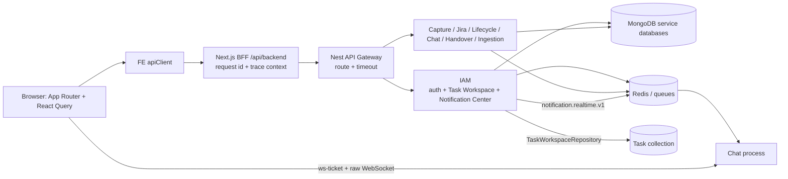

# Báo cáo kiểm tra và xử lý luồng request toàn hệ thống

- **Ngày cập nhật:** 2026-10-24
- **Phạm vi:** DATN-FE, DATN-BE, product_docs; từ React Query/App Router → BFF → API Gateway → service/repository → MongoDB/Redis/BullMQ/realtime.
- **Baseline được audit:** FE `be909812c9e52bfdbc3803c4cd579cc44cbd3707`; BE `1b00e47b9d6daf69615c0dbcd9cb1eebb3501a92`; Docs `1f42e6e19c18f5770ca68f6067445c180865720d`.
- **Các nhánh xử lý:** `fix/DanhDEV-request-flow-audit-fe-ui`, `fix/DanhDEV-request-flow-audit-be-api`, `docs/DanhDEV-request-flow-audit`.

## Kết quả điều hành

Đã đối chiếu đủ 9 finding trong audit với mã nguồn hiện tại, contract sản phẩm và tài liệu kỹ thuật chính thức. RF-01 đến RF-06 đã được xác nhận là lỗi nguồn và có xử lý. RF-07 đúng một phần: Task Workspace đang được host trong IAM process, nên mô tả “scheduler ở process domain khác” không chính xác; vấn đề thật là scheduler bỏ qua repository sở hữu Task. RF-08 là thiếu sót thật và đã bổ sung tracing tùy chọn qua HTTP, BullMQ và notification realtime. RF-09 đúng về khả năng fan-out nhưng ảnh chụp không chứng minh production đang nghẽn; đã giới hạn đồng thời, tái sử dụng ACL lookup và khôi phục các index notification bị thiếu trong catalog development. Explain sau migration dùng index cho list/unread trên mẫu 19 notification; số liệu này không đại diện cho production.

Ảnh Network người dùng gửi thấy các tên `me`, `organizations`, `invitations`, `select-organization`, `projects`, `unread-count`, `notifications`, `ws-ticket`, `dashboard?_rsc=...`; ảnh không có Status/Timing/HAR. Vì vậy dấu X đỏ không đủ để kết luận là 401/403/5xx, request trùng không đủ để kết luận lỗi server. `_rsc` là request nội bộ của App Router/RSC, không phải API backend độc lập; xem [Next.js: CDN caching và RSC requests](https://nextjs.org/docs/app/guides/cdn-caching).

## 1. Luồng runtime đã xác minh

FE gọi BFF `/api/backend`; BFF gắn `x-request-id` nếu thiếu và Gateway/service duy trì request ID. Trong deployment microservices, Gateway route notification tới IAM; notification process riêng hiện chỉ health-check. Task Workspace vẫn nằm trong IAM runtime, nhưng `TaskWorkspaceRepository` là ranh giới truy cập Task data. Audit không bật standalone Task runtime và không thay đổi gate của Task. Ở local source hiện tại, `CONTINUUM_API_BASE_URL` mặc định là `http://localhost:3001`; biến `GATEWAY_PORT=3002` của BE không tự đổi đích gọi BFF. Worktree FE không có `.env` runtime riêng, nên listener đang chạy có thể bị process-level override mà source không chứng minh được.

## 2. Kiểm định finding và trạng thái

| ID | Kết luận | Bằng chứng / tác động | Xử lý trong nhánh audit |
|---|---|---|---|
| RF-01 | **Đúng** | Hai GET notification trước đây gọi `evaluateTaskDeadlines()`, khiến read request có thể quét Task và ghi Notification. | **Đã sửa BE:** bỏ side effect khỏi GET list/unread-count; scheduler chạy theo timer; test xác nhận read endpoint không gọi scan. |
| RF-02 | **Đúng** | FE tải list dù dropdown đóng và gọi count song song trong khi list đã trả `unreadCount`. Polling 15 giây không khớp contract 30 giây. | **Đã sửa FE:** dropdown đóng chỉ query count; mở dropdown mới tải list và dùng count trong response list; nhịp poll thành 30 giây. |
| RF-03 | **Đúng** | Select-organization POST trả identity mới, nhưng FE invalidate lại `me` và organization options, tạo GET không cần thiết. | **Đã sửa FE:** dùng response POST làm cache identity; vẫn xóa tenant-scoped query cũ để tránh dùng dữ liệu organization trước. |
| RF-04 | **Đúng** | Header/settings/sidebar khởi chạy project query khi chưa mở. Hook còn tuần tự tải mọi page, làm shell có thể phát nhiều request theo quy mô tenant. | **Đã sửa FE/BE:** query chỉ bật khi khu vực cần dữ liệu mở; bỏ auto-fetch mọi page; dùng page 20; header search debounce 250ms và chỉ gửi khi ≥2 ký tự; API hỗ trợ `q` literal, giới hạn 2–80 ký tự và phân trang. Sidebar có đường vào trang Projects khi còn project ngoài page đầu. |
| RF-05 | **Đúng** | Contract cũ nói Socket.IO `/ws/notifications`, nhưng runtime là raw WebSocket của Chat, cấp vé một lần. EventEmitter chỉ ở process; không truyền IAM → Chat. | **Đã sửa BE/docs:** giữ giao thức raw WebSocket hiện hữu; IAM phát envelope version 1 qua Redis Pub/Sub `<BULLMQ_PREFIX>:notification.realtime.v1`; Chat chỉ gửi tới recipient cùng organization; contract notification được sửa cho khớp code. Mongo Notification là nguồn sự thật; polling 30 giây phục hồi trạng thái nếu mất event realtime. |
| RF-06 | **Đúng** | Scheduler có provider tại IAM và Notification; static flag chỉ khóa trong một process. | **Đã sửa BE:** scheduler chỉ được đăng ký trong IAM; Redis lease có owner token, TTL 120 giây, renew 30 giây, release compare-owner; scan dừng khi lease không còn hợp lệ; eventKey/idempotency bảo vệ ghi notification lặp. Nếu node bị pause vượt lease, có thể có scan chồng trong một khoảng ngắn; notification vẫn idempotent. |
| RF-07 | **Đúng một phần** | “Khác process/service” là sai: Task Workspace được host trong IAM. Nhưng scheduler đọc collection trực tiếp thay vì gọi Task repository. | **Đã sửa BE:** cursor scan deadline và kiểm tra task target đi qua `TaskWorkspaceRepository`. Tạo migration riêng `20261024-task-deadline-scan-index` theo quy trình repo (không sửa migration cũ); áp dụng với task writes paused và reviewed hash. Read-only kiểm tra sau apply xác nhận index `deadline_scan_due_cursor`, 61 task, không conflict; migration không sửa document/validator. Không khởi chạy standalone Task process. |
| RF-08 | **Đúng** | Request ID/metrics không tạo dependency span xuyên BFF → Gateway → service hoặc queue/realtime. | **Đã sửa FE/BE:** instrumentation OTel tùy chọn ở Next `instrumentation.ts` và active Node entrypoints; HTTP/undici auto-instrumentation; BullMQ telemetry trên producers/workers; notification Redis envelope chỉ mang W3C `traceparent`/`tracestate` và Chat tạo consumer span. Endpoint trống thì tracing không khởi tạo. Có profile Jaeger cục bộ trong Compose. |
| RF-09 | **Đúng một phần** | Notification list có query trang + unread count + ACL lookup theo target. Điều này tạo thêm DB work; ảnh không có latency, volume hay Status để chứng minh production bottleneck. Explain read-only trên development ban đầu thấy cả list/count quét collection 19 document vì catalog thiếu index khai báo. | **Đã giảm rủi ro:** ACL checks tối đa 12 concurrent, target trùng loại bỏ, project/organization membership lookup memoize trong request; ACL lỗi fail-closed và che nội dung. Đã áp migration versioned cho bốn index persistence còn thiếu sau preflight (0 document quá TTL, 0 event key trùng), rồi explain xác nhận list/unread dùng IXSCAN: 6 key / 3 document trên mẫu hiện tại. Không suy rộng kết quả dev thành p95/production. |

## 3. Quyết định thiết kế dựa trên tài liệu bên ngoài

| Vấn đề | Thực hành được tài liệu chính thức khuyến nghị | Áp dụng ở đây |
|---|---|---|
| Query thừa từ UI | TanStack Query tách polling timer khỏi `staleTime`; query không cần hiển thị nên disable, dữ liệu dùng chung nên được cache theo key. [Important Defaults](https://tanstack.com/query/latest/docs/framework/react/guides/important-defaults), [Polling](https://tanstack.com/query/latest/docs/framework/react/guides/polling) | Chỉ enable query khi mở menu; dùng response list thay request count trùng; giữ 30 giây làm nhịp fallback. |
| Event liên process | Redis Pub/Sub phù hợp phát realtime nhưng at-most-once, không lưu message để replay. [Redis Pub/Sub](https://redis.io/docs/latest/develop/use-cases/pub-sub/), [Redis Pub/Sub cho Node.js](https://redis.io/docs/latest/develop/use-cases/pub-sub/nodejs/) | Redis chỉ báo thức realtime; Notification đã persist trong Mongo, polling phục hồi badge/list. AWS khuyến nghị transactional outbox khi phải bảo đảm việc DB commit và phát event là một giao dịch bền vững; điều đó chưa cần cho badge có durable read fallback, nhưng là hướng nâng cấp nếu cần consumer business effect hoặc SLA giao event chặt hơn. [AWS Transactional Outbox](https://docs.aws.amazon.com/prescriptive-guidance/latest/cloud-design-patterns/transactional-outbox.html) |
| Scheduler chạy nhiều instance | Nest scheduled job khởi chạy tại mỗi app instance; distributed lock cần shared coordination. [Nest Task Scheduling](https://docs.nestjs.com/techniques/task-scheduling), [Nest Distributed Locks](https://docs.nestjs.com/reliability/locks) | Chỉ IAM làm owner, shared Redis lease phối hợp instance; deterministic eventKey giảm hậu quả duplicate. Đây là at-least-once/idempotent behavior, không tuyên bố exactly-once. |
| Trace qua service/queue | OpenTelemetry truyền W3C context giữa process; Next yêu cầu đăng ký instrumentation sớm; BullMQ có adapter OpenTelemetry cho producer/consumer context. [OTel JS propagation](https://opentelemetry.io/docs/languages/js/propagation/), [Next instrumentation](https://nextjs.org/docs/app/guides/instrumentation), [BullMQ telemetry](https://docs.bullmq.io/guide/telemetry/), [BullMQ getting started](https://docs.bullmq.io/guide/telemetry/getting-started) | Tracing bật bằng endpoint cấu hình; sample ratio mặc định 0.1 trong example; không thêm user/organization ID hoặc URL động làm span attributes. Redis notification carrier chỉ whitelist `traceparent` và `tracestate`. |
| Tối ưu Mongo | Cần kiểm tra đúng filter/sort/index bằng `explain("executionStats")`; không thêm index theo phỏng đoán. [Analyze Query Plan](https://www.mongodb.com/docs/manual/tutorial/analyze-query-plan/). Index build mới có thể giữ lock ngắn lúc bắt đầu/kết thúc và ảnh hưởng write throughput; chọn maintenance window nếu write-heavy. [MongoDB 7 Index Builds](https://www.mongodb.com/docs/v7.0/core/index-creation/) | Deadline scan dùng `{ dueDate: 1, _id: 1 }`. Explain notification trước migration chứng minh list/count COLLSCAN trên collection development 19 document; catalog thiếu bốn index đã khai báo trong persistence. Sau preflight, migration đã khôi phục các index còn thiếu; explain chuyển sang IXSCAN. Cần đo lại trên workload/dataset production trước khi kết luận p95 hoặc thay đổi index tiếp. |
| Retry/failure ở hệ phân tán | AWS khuyến nghị retry hữu hạn với backoff/jitter và idempotency để tránh retry storm. [AWS Retry with Backoff](https://docs.aws.amazon.com/prescriptive-guidance/latest/cloud-design-patterns/retry-backoff.html), [AWS idempotent API guidance](https://aws.amazon.com/builders-library/making-retries-safe-with-idempotent-APIs/) | Không thêm retry tự động cho các query UI không cần thiết; event scheduler dùng eventKey; realtime lỗi không rollback mutation đã commit và durable poll vẫn phục hồi. |

## 4. Nội dung đã thay đổi theo nhánh

### FE — `fix/DanhDEV-request-flow-audit-fe-ui`

- Lazy-load notification list/settings/project sidebar theo trạng thái menu; notification badge chỉ có một nguồn query tại một thời điểm.
- Poll notification 30 giây; chọn organization không invalidate lại identity/options đã có trong response.
- Project query trả đúng page được yêu cầu thay vì tự kéo hết `totalPages`; shell dùng page 20.
- Header project search debounce, gọi server search khi đủ 2 ký tự.
- Bổ sung optional OTel registration cho Next Node BFF; `.env.example` có endpoint/sampler; `.env` runtime không bị sửa.

### BE — `fix/DanhDEV-request-flow-audit-be-api`

- Deadline scan không còn chạy trong GET; scheduler chỉ ở IAM, có Redis lease renew/release; Task data đi qua TaskWorkspaceRepository và cursor/index. Versioned migrations có preflight/hash cho deadline cursor và notification indexes.
- Đồng bộ `deadline_scan_due_cursor` trong Task Workspace migration catalog và kiểm tra test để runtime/migration cùng khai báo index.
- Notification bus publish qua Redis; Chat subscribe, validate event envelope, scope recipient theo organization và tạo consumer span; polling vẫn fallback.
- ACL target checks giới hạn concurrency, dedupe, cache lookup theo resource trong request và redact khi dependency ACL lỗi.
- Project API nhận `q` 2–80 ký tự, regex metacharacters được escape; OpenAPI cập nhật. Follow-up cho autocomplete: `includeTotal=false` chỉ dùng kèm `q`, BE lấy thêm một row để trả `hasMore` và bỏ exact `countDocuments`; mặc định các màn danh sách vẫn trả `totalItems/totalPages` như cũ.
- OTel auto-instrumentation bật có điều kiện; BullMQ producers/processors dùng telemetry adapter; service name theo entrypoint; Jaeger `all-in-one` chỉ bật với profile `observability`.
- Chỉ sửa `.env.example`/Compose; giữ nguyên `.env` đã cập nhật gồm `GATEWAY_PORT=3002`, `IAM_GATEWAY_SECRET`, `SERVICE_DATABASE=continuum_iam` cùng SAG/R2/AWS settings.

### Docs — `docs/DanhDEV-request-flow-audit`

- Sửa contract notification từ Socket.IO giả định sang raw WebSocket/ticket flow và Redis channel đang chạy.
- Báo cáo này ghi lại phân loại đúng/sai, quyết định kiến trúc, nguồn nghiên cứu và giới hạn bằng chứng.

## 5. Xác minh

| Hạng mục | Kết quả |
|---|---|
| FE `npm run check` | **Pass:** lint, typecheck, 108 test files / 787 tests, Next production build |
| BE `npm run check` | **Pass:** lint, typecheck, safety suites (15 + 25), unit tests (1,372 passed / 135 skipped), e2e (108 passed / 4 skipped), Nest build |
| Deadline index migration | **Pass:** plan tests 4/4; dry-run `20261024-task-deadline-scan-index` trên `continuum_task` clean, 61 task, action `CREATE`, 0 conflict; apply exact hash `5207ea877599144358d82c38930d51209e57f8f57361e92586f48854463fd446`; post-check action `NOOP`, 0 conflict |
| Notification index migration | **Pass:** planner tests 4/4; development Atlas `continuum_notification` có 19 document, 0 document quá TTL, 0 event-key duplicate; tạo bốn index còn thiếu theo persistence với dry-run hash `bea64d823c4dd86e33c84d3121f3a4dc2a8991151ce253c963c62c8d5ac0a95d`; post-check đủ 5/5 index `NOOP`, 0 conflict, hash `579edb39e115acceb8ebafeb0fb7d649a20a55f668b908b9f6905fceab5a4412`; không sửa/xóa document |
| So sánh Workspace catalog với MongoDB | Trước apply: đủ 8 collection, 0 validator mismatch, 0 index conflict, chỉ thiếu `tasks.deadline_scan_due_cursor`; sau apply: runtime catalog khớp |
| Compose YAML | Cấu hình parse được khi cấp dummy values cho required secrets; không in/đọc secret runtime |
| Runtime đang chạy | FE và BE hiện chạy từ hai audit worktree: Next dev `3000` dùng output cô lập `.next-dev`; BFF mặc định gọi `3001`. Audit BE trên `3001` trả `200` tại `/api/v1/health`. Probe không cookie nhận redirect `307` ở `/en/projects/new` và `401` ở `/api/backend/auth/me`, đúng nhánh yêu cầu đăng nhập. `.env` cho biết `NODE_ENV=development`, `DATN_DB_ENV=development`; Mongo URI là Atlas DNS nên đây là development Atlas, không phải loopback/local. Gateway `3002` và IAM audit `3003` chưa chạy; BE đang dùng monolith topology, không có `/internal/health` để Gateway route. |
| DB migration apply | **Pass:** Task writer `3001` được tạm dừng; tạo một index non-unique trong `continuum_task`; Task document count giữ 61. Dry-run hash `5207ea877599144358d82c38930d51209e57f8f57361e92586f48854463fd446`; post-state hash `a34c6a655c93e5878fe61293e0878a4186042a0b3b22a04846ae5ce76ea464f9`. Notification writer `3001` cũng được tạm dừng; tạo đúng bốn index persistence thiếu trong development Atlas `continuum_notification`; count giữ 19. Không sửa `.env`. |
| Read-only explain trên development DB | Trước notification migration: list `COLLSCAN`, 19 document examined; unread count `COLLSCAN`, 19 document examined. Sau migration: list dùng `recipientId_1_createdAt_-1` + `recipientUserId_1_isRead_1_createdAt_1`, 6 key / 3 document; unread count dùng hai IXSCAN tương ứng, 6 key / 3 document. Task deadline scan dùng `deadline_scan_due_cursor`, 3 key / 3 document; project search sample dùng `organizationId_1_code_1`, 25 key / 25 document. Mẫu nhỏ, không phải benchmark production. |
| Production request/error rates, HAR, Mongo executionStats | Chưa có trong ảnh đầu vào; không thể kết luận chính xác các dấu X hoặc p95/bottleneck production |

## 6. Cấu hình tracing tùy chọn

- Tracing tắt khi `OTEL_EXPORTER_OTLP_ENDPOINT` để trống.
- Local Node process: đặt endpoint theo collector đang chạy, ví dụ `http://localhost:4318`.
- Docker Compose: bật service Jaeger bằng profile `observability`, rồi đặt `OTEL_EXPORTER_OTLP_ENDPOINT=http://jaeger:4318` trong môi trường Compose; UI Jaeger ở `http://localhost:16686`.
- Ports `3000`/`3001` trong Compose là internal defaults hiện có. Local `.env` user settings như Gateway `3002` không bị ghi đè bởi thay đổi tracing.

## 7. Giới hạn và bước đo tiếp theo

Source-level request findings đã được xử lý và kiểm tra; deadline index và các index notification còn thiếu đã được áp dụng, xác minh trên development Atlas. Audit FE/BE đang chạy trực tiếp từ worktree trên `3000`/`3001`. Gateway `3002` chưa được nối vào FE vì BFF mặc định dùng `3001` và BE đang chạy monolith; topology Gateway cần standalone IAM và service URL phù hợp. Hai kết luận cần production telemetry mới quyết định được: (1) request dấu X thất bại hay bị hủy/refresh/RSC; (2) notification list/count hoặc project search có vượt p95/query-cost budget. Explain xác nhận list/count chuyển từ COLLSCAN sang IXSCAN sau khi đồng bộ index catalog, nhưng dataset development chỉ có 19 notification. Cần HAR có Status/Timing và Mongo `executionStats`/slow-query sample trên dataset an toàn để kết luận production; không suy p95 từ development.

## 8. Follow-up: chi phí project autocomplete

- FE header search gửi `includeTotal=false` và chỉ yêu cầu 8 kết quả hiển thị. BE vẫn giữ nguyên tìm chuỗi con không phân biệt hoa thường; chỉ bỏ truy vấn đếm chính xác ở đường autocomplete, lấy `pageSize + 1` để trả `hasMore`. Project directory không gửi cờ này nên vẫn có phân trang exact count. API thêm metadata `pagination.hasMore` cho chế độ autocomplete; không thay đổi schema, index hay dữ liệu MongoDB.
- Đo baseline chỉ đọc trên development Atlas `continuum_iam`: collection có 35 project; tenant lớn nhất có 25. Truy vấn ACTIVE với chuỗi 2 ký tự khớp 18 kết quả dùng `IXSCAN` trên index tenant/code nhưng xét 25 keys và 25 documents, đồng thời có stage `SORT`; truy vấn count tương ứng cũng xét 25 keys và 25 documents. Thời gian explain ghi 0 ms / 1 ms trên mẫu nhỏ, không đại diện p95 hay tải production.
- `q` tiếp tục dùng literal case-insensitive regex để không đổi hành vi người dùng. MongoDB ghi rõ `$regex` với `i` không tận dụng case-insensitive index; prefix regex có thể tối ưu khi được neo đầu chuỗi và phân biệt hoa thường. Xem [MongoDB `$regex` index use](https://www.mongodb.com/docs/manual/reference/operator/query/regex/) và [case-insensitive indexes](https://www.mongodb.com/docs/manual/core/index-case-insensitive/).
- Bước còn lại trước khi đổi chiến lược tìm kiếm: chạy explain và tải đại diện trên tenant lớn/safe production-like dataset; đo list, exact count, số keys/documents examined, `SORT`, p95 và tần suất query. Nếu semantics prefix được chấp nhận, chuẩn hóa trường và dùng prefix index; nếu phải giữ substring, đánh giá MongoDB Search/ngram hoặc dịch vụ search chuyên dụng. Không thêm index B-tree theo phỏng đoán.
- Follow-up code đã được cập nhật trên các nhánh PR FE/BE hiện có. Chưa chạy test/build cho follow-up này; số liệu trên chỉ là read-only explain trước tối ưu, không phải xác nhận runtime sau thay đổi.
